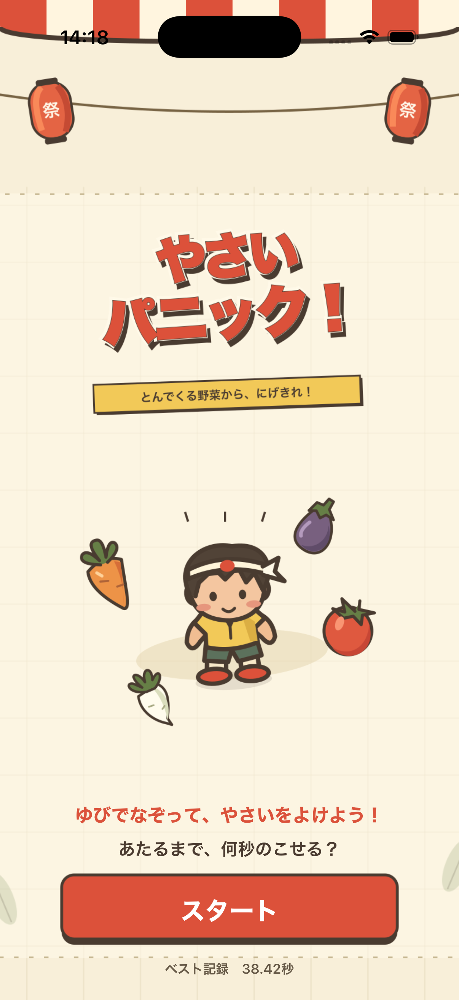

# 日専祭アプリ：やさいパニック！

> **チーム：** Dream 26cm0109 キルへカン　26cm0103イデ 26cm0104オオハシ  
> **AI利用レベル：** 2（生成コード可）  
> **最終更新：** 2026-10-26

> 💡 制作の進め方は担任の先生から案内があります。このファイルの項目は、担任の先生の指示で増えることがあります。

---

## 何ができるアプリか（3行）

（例：買い物リストを作るアプリ。品名を入力して追加できる。買ったものにチェックを付けると一覧から消える。）

スタートを押すと、野菜をよけるゲームが始まります。  
子どもを指で動かし、野菜に当たるまでの時間を競います。  
結果は名前を付けてTOP 10に保存でき、もう一度遊べます。

## 画面

スタート画面、ゲーム中の画面、結果画面があります。

1. 「スタート」を押すとゲームが始まります。
2. 画面を指でなぞって子どもを動かし、飛んでくる野菜をよけます。
3. 野菜に当たるとゲームが終わり、生存時間とランキングが出ます。
4. ランキングに入ったら名前を入力し、「保存」を押します。空欄の場合は「ななし」になります。
5. 「もう一度あそぶ」で再挑戦できます。「タイトルにもどる」で最初の画面にもどれます。

## 使った文法・技術

（例：`@State`、`List`、`ForEach`、構造体、配列の `append` と `remove`）

画面の切り替えに @State と if を使いました。野菜の動きには SpriteKit、記録の保存には UserDefaults を使いました。
名前と時間は構造体にまとめ、配列でランキングを管理しました。ランキングの表示には `ForEach` を使いました。

## 生成AIの使い方（どの場面で、どう使ったか）

（例：画面の骨組みは ChatGPT に書いてもらった。削除ボタンが効かなかったので、原因を質問して直した。）

画像やコードを作るときにChatGPTを使いました。3人分のコードを合わせる方法や、エラーの直し方も相談しました。
ボタンの文字や画面の説明も、日本語にそろえるように相談しました。作ったあとにiPhoneで動きを確認しました。

## 展示で工夫した点

（例：文字を大きくして、来場者が操作しやすいようにした。）

スタートボタンと時間を大きくして、初めての人でも遊びやすくしました。ゲームが終わったら、すぐ次の人が挑戦できます。
野菜や背景の色をそろえて、お祭りの雰囲気にしました。記録に名前を付けられるので、友達と比べて遊べます。
結果画面には「タイトルにもどる」ボタンも付けました。
